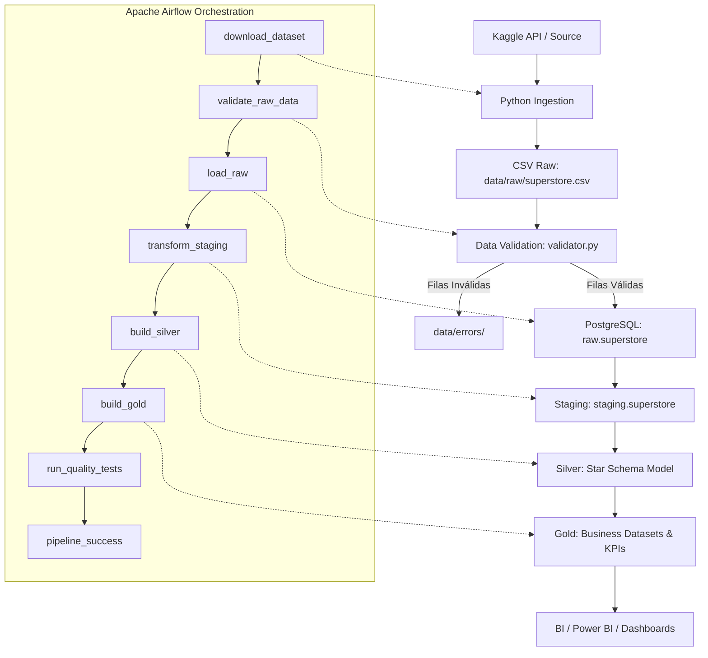

# 🛒 Superstore Sales End-to-End Data Pipeline

Pipeline de datos de extremo a extremo para el dataset **Superstore Sales** de Kaggle, diseñado con un enfoque de producción, limpio, reproducible y estructurado por capas sin sobre-ingeniería innecesaria.

---

## 📌 1. Descripción del Proyecto

Este proyecto implementa el ciclo de vida completo de ingeniería de datos:
1. **Ingesta Programática:** Descarga automática desde Kaggle (vía Kaggle API / CLI) o réplica verificada con registro de metadatos (hash SHA-256, tamaño, timestamp y conteo de filas).
2. **Capa Raw:** Preservación íntegra e inmutable del archivo fuente en `data/raw/superstore.csv`.
3. **Validación de Calidad:** Verificación estricta de schema, campos requeridos no nulos, parseabilidad de fechas, coherencia cronológica y rangos numéricos. Las anomalías se aíslan en `data/errors/`.
4. **Carga en PostgreSQL:** Ingesta idempotente en `raw.superstore`.
5. **Staging:** Limpieza técnica, conversión a `snake_case`, tipado estricto y estandarización en `staging.superstore`.
6. **Capa Silver (Modelo Dimensional):** Creación de un **Star Schema** limpio y deduplicado (`dim_date`, `dim_customers`, `dim_products`, `dim_geography`, `fact_sales`).
7. **Capa Gold (Analítica & KPIs):** Tablas agregadas listas para consumo de negocio y BI (`daily_sales`, `monthly_sales`, `category_performance`, `product_performance`, `customer_performance`, `regional_performance`).
8. **Testing Automatizado:** Suite de pruebas con Pytest para validar supuestos de datos y consistencia matemática.
9. **Orquestación:** DAG modular en **Apache Airflow** con políticas de reintentos, timeouts y logging estructurado.

---

## 🏛️ 2. Arquitectura del Pipeline

El siguiente diagrama detalla el flujo de datos y la orquestación del sistema:



---

### 💡 2.1 El Flujo Explicado de Forma Sencilla (Para Estudiantes y Exposiciones)

Para entender este proyecto como si estuviéramos repasando entre compañeros de estudio, imagínalo como una **planta de tratamiento de agua o una fábrica**: el dato entra "crudo y sucio" desde internet, pasa por filtros de control de calidad, se limpia, se ordena en estantes y termina convertido en un producto final listo para que la gerencia tome decisiones en dashboards (Power BI):

1. **Ingesta (`src/ingestion/download.py` — El Repartidor):**  
   Va a internet (usando la API de Kaggle o una réplica verificada) y descarga el archivo original en `data/raw/superstore.csv`. Registra su tamaño, fecha y un hash SHA-256 (su huella digital) para garantizar que el archivo fuente nunca sea alterado.
2. **Validación (`src/validation/validator.py` — El Guardia de Seguridad):**  
   Inspecciona el archivo antes de que toque la base de datos. Verifica que estén las 21 columnas esperadas, que no haya valores nulos prohibidos, que los precios sean positivos y que las fechas sean lógicas (`Ship Date >= Order Date`). Si existieran filas corruptas, las aísla en `data/errors/` explicando la razón del fallo.
3. **Capa Raw (`raw.superstore` — La Fotocopia de Seguridad):**  
   Copia el dataset en PostgreSQL tal cual viene en el CSV (guardando todo como texto). Sirve como respaldo fidedigno para auditorías futuras.
4. **Capa Staging (`staging.superstore` — El Lavado de Cara Técnico):**  
   Pone orden al formato: convierte nombres de columnas a `snake_case` (de `Order Date` a `order_date`), convierte tipos de datos a fechas (`DATE`) y números (`NUMERIC`), y calcula columnas operativas como `days_to_ship`.
5. **Capa Silver (`silver.*` — El Orden de los Estantes / Star Schema):**  
   En el archivo plano original el nombre de un cliente se repetía decenas de veces. En Silver separamos la información en un **modelo de estrella**:
   - **Dimensiones:** `dim_customers` (793 clientes únicos), `dim_products` (1,862 productos deduplicados con su nombre más reciente), `dim_date` (un calendario completo con año, mes y fines de semana) y `dim_geography` (ubicaciones únicas).
   - **Tabla de Hechos (`fact_sales`):** Contiene los números clave (`sales`, `quantity`, `discount`, `profit`) conectados a las dimensiones mediante llaves foráneas.
6. **Capa Gold (`gold.*` — El Producto Listo para la Gerencia):**  
   Genera datasets precalculados con KPIs de negocio para que las herramientas de BI no hagan cálculos lentos en vivo: ventas diarias/mensuales, rentabilidad por categoría, productos estrella vs generadores de pérdidas, y márgenes por estado.
7. **Testing Automatizado (`tests/` — El Inspector de Calidad):**  
   Ejecuta 21 pruebas automáticas con **Pytest** para validar que las matemáticas cuadren (por ejemplo: que la suma de ventas por categoría coincida exactamente con las ventas totales de la empresa) y que ninguna tabla esté vacía.
8. **Orquestación (`dags/` — El Director de Orquesta):**  
   **Apache Airflow** vigila y corre todo el pipeline de manera desatendida. Si algo falla, reintenta automáticamente o emite alertas.

---

## 🛠️ 3. Tecnologías y Librerías: ¿Qué Hace Cada Una?

| Tecnología / Librería | ¿Qué es en palabras sencillas? | ¿Para qué la usamos en este proyecto? |
| :--- | :--- | :--- |
| **Python** | El capataz de la obra | Lenguaje principal que coordina todo: descarga archivos, corre validaciones y envía instrucciones a la base de datos. |
| **PostgreSQL 16** | El almacén central | Motor de base de datos relacional donde viven los 4 schemas separados (`raw`, `staging`, `silver`, `gold`). |
| **SQL** | El idioma del almacén | Las transformaciones pesadas (limpiar, deduplicar y agrupar KPIs) se ejecutan directamente en la base de datos con SQL por máxima velocidad. |
| **Apache Airflow** | El despertador / Maestro de orquesta | Planifica y ejecuta el flujo completo de forma automática. Muestra un panel web visual para ver el progreso de cada tarea. |
| **Docker Compose** | La caja portátil | Con un solo comando (`docker compose up -d`) levanta PostgreSQL y Airflow en contenedores aislados sin ensuciar tu computadora. |
| **Pandas & NumPy** | La lupa analítica | Librerías para manipular tablas en memoria. Las usamos en la validación inicial y en el notebook EDA para revisar distribuciones y nulos. |
| **SQLAlchemy** | El traductor universal | Permite que nuestro código Python se comunique de forma limpia y estructurada con bases de datos SQL. |
| **Psycopg (psycopg3 / psycopg2)** | El cable de conexión | Driver que conecta físicamente a Python con PostgreSQL a través de la red (puerto 5432). |
| **Kaggle API / Requests** | El mensajero de internet | Permite descargar datasets programáticamente desde Kaggle mediante autenticación por token, o descargar desde enlaces HTTP. |
| **Pytest** | El auditor de calidad | Corre las 21 pruebas automáticas en segundos y nos da una luz verde si todo cumple con los supuestos de calidad. |
| **Python-dotenv** | El cajón con llave | Lee las credenciales del archivo secreto `.env` para que contraseñas y claves API nunca queden expuestas en Git. |

> **Nota:** No se introdujo Spark, Kafka, Kubernetes ni dbt para mantener el proyecto reproducible, simple y enfocado en los principios fundamentales de ingeniería de datos.


---

## 📁 4. Estructura del Repositorio

```text
arquitectura_pipeline/
│
├── data/
│   ├── raw/                  # Datos crudos inmutables y metadatos de ingesta
│   ├── processed/            # Artefactos procesados intermedios (opcional)
│   └── errors/               # Registros rechazados durante la validación
│
├── src/
│   ├── ingestion/            # Descarga desde Kaggle / fuente verificada y metadatos
│   ├── validation/           # Reglas de validación y reporte de calidad
│   ├── transformation/       # Ejecutor de scripts SQL de staging, silver y gold
│   ├── loading/              # Carga idempotente en PostgreSQL
│   ├── utils/                # Logging unificado, conexión a DB y generador de dashboard
│   └── pipeline.py           # Orquestador ejecutable en línea de comandos (CLI)
│
├── sql/
│   ├── init_db.sql           # Creación de schemas (raw, staging, silver, gold)
│   ├── raw/                  # DDL de raw.superstore
│   ├── staging/              # Transformación y estandarización técnica
│   ├── silver/               # Modelo dimensional (dim_*, fact_sales)
│   └── gold/                 # Tablas agregadas y KPIs analíticos
│
├── dags/
│   └── superstore_pipeline_dag.py  # DAG de Apache Airflow
│
├── tests/
│   ├── test_validation.py    # Pruebas de validación de schema y rechazo de errores
│   ├── test_transformations.py # Pruebas de lógica matemática (márgenes, AOV, descuentos)
│   ├── test_data_quality.py  # Pruebas de supuestos del dataset
│   └── test_database_quality.py # Pruebas de integración contra PostgreSQL
│
├── notebooks/
│   └── 01_exploration.ipynb  # Notebook de EDA con gráficos (matplotlib/seaborn)
│
├── docs/
│   ├── data_dictionary.md    # Diccionario de datos exhaustivo
│   ├── dashboard.md          # Especificación de dashboard analítico y medidas DAX
│   └── dashboard.html        # Dashboard analítico web interactivo
│
├── index.html                # Interfaz web del dashboard interactivo (raíz para localhost:8000)
├── docker-compose.yml        # Configuración de PostgreSQL y Airflow
├── requirements.txt          # Dependencias de Python
├── .env.example              # Plantilla de variables de entorno
├── .gitignore                # Reglas de exclusión de Git
└── README.md                 # Documentación técnica del proyecto
```

---

## ⚙️ 5. Configuración y Credenciales

### 5.1 Configuración de Variables de Entorno
Copia la plantilla `.env.example` para crear tu archivo `.env`:

```bash
cp .env.example .env
```

El archivo `.env` contiene:
```ini
# Kaggle API Credentials
KAGGLE_USERNAME=tu_usuario_kaggle
KAGGLE_KEY=tu_api_key_kaggle
KAGGLE_DATASET=bravehart101/sample-superstore-dataset

# PostgreSQL Database Connection
POSTGRES_HOST=localhost
POSTGRES_PORT=5432
POSTGRES_DB=superstore_db
POSTGRES_USER=postgres
POSTGRES_PASSWORD=postgres

# Database Schemas
POSTGRES_SCHEMA_RAW=raw
POSTGRES_SCHEMA_STAGING=staging
POSTGRES_SCHEMA_SILVER=silver
POSTGRES_SCHEMA_GOLD=gold
```

### 5.2 Autenticación con Kaggle
1. Ingresa a tu cuenta de Kaggle en [kaggle.com/settings/account](https://www.kaggle.com/settings/account).
2. En la sección **API**, haz clic en **"Create New Token"**. Se descargará un archivo `kaggle.json`.
3. Tienes dos opciones para autenticarte:
   - **Opción A (Recomendada):** Copiar los valores `username` y `key` del archivo en las variables `KAGGLE_USERNAME` y `KAGGLE_KEY` de tu archivo `.env`.
   - **Opción B:** Colocar el archivo directamente en `~/.kaggle/kaggle.json` y darle permisos:
     ```bash
     mkdir -p ~/.kaggle
     cp kaggle.json ~/.kaggle/
     chmod 600 ~/.kaggle/kaggle.json
     ```
> **Nota de Resiliencia:** Si no configuras las credenciales de Kaggle, el pipeline descargará automáticamente el dataset idéntico de 9,994 filas desde su réplica verificada para garantizar total reproducibilidad.

---

## 🚀 6. Instalación y Ejecución Local

### Paso 1: Crear el entorno virtual e instalar dependencias
```bash
python3 -m venv .venv
source .venv/bin/activate
pip install -r requirements.txt
```

### Paso 2: Iniciar PostgreSQL y Airflow con Docker Compose
```bash
docker compose up -d
```
Verifica que los servicios estén activos:
```bash
docker compose ps
```
- **PostgreSQL:** escuchando en el puerto `5432`.
- **Airflow UI:** disponible en [http://localhost:8080](http://localhost:8080) (usuario predeterminado: `admin`, contraseña generada en el log de inicio o configurada en standalone).

### Paso 3: Ejecutar el Pipeline Completo
Puedes ejecutar el pipeline directamente mediante el runner de Python:
```bash
python3 src/pipeline.py
```

Salida esperada en consola:
```text
2026-10-07 10:00:00 INFO Starting ingestion
2026-10-07 10:00:02 INFO Rows detected: 9994
2026-10-07 10:00:02 INFO Ingestion metadata written to data/raw/ingestion_metadata.json
2026-10-07 10:00:02 INFO Starting data validation on: data/raw/superstore.csv
========================================
VALIDATION RESULT
Rows checked: 9994
Valid rows: 9994
Invalid rows: 0

Checks:
✓ Required columns
✓ Data types
✓ Null values
✓ Dates
✓ Numeric values
✓ Duplicate IDs
========================================
2026-10-07 10:00:03 INFO Validation passed
2026-10-07 10:00:03 INFO Visual Analytics Dashboard generated at: file:///.../docs/dashboard.html
2026-10-07 10:00:05 INFO Raw table loaded
2026-10-07 10:00:06 INFO Staging transformation completed
2026-10-07 10:00:07 INFO Silver transformation completed
2026-10-07 10:00:08 INFO Gold tables created
2026-10-07 10:00:09 INFO Quality tests passed
2026-10-07 10:00:09 INFO Pipeline executed successfully!
```

### Paso 4: Visualizar el Dashboard Web Interactivo
El pipeline compila automáticamente una interfaz web analítica con tema oscuro y gráficos dinámicos con **Chart.js**:

1. Inicia el servidor web local:
   ```bash
   python3 -m http.server 8000
   ```
2. Abre en tu navegador:
   👉 **[http://localhost:8000](http://localhost:8000)** (o abre directamente [docs/dashboard.html](docs/dashboard.html))

---

## 📊 7. Visualización Gráfica de los Datos (3 Formas Disponibles)

El proyecto ofrece 3 modalidades para visualizar y analizar los resultados según el perfil de usuario:

| Modalidad | Archivo / Acceso | Tecnologías | Uso Recomendado |
| :--- | :--- | :--- | :--- |
| **1. Dashboard Web Interactivo** | `http://localhost:8000` o `docs/dashboard.html` | HTML5, Vanilla CSS, Chart.js | Visualización instantánea en navegador sin dependencias ni bases de datos. |
| **2. Jupyter Notebook** | [notebooks/01_exploration.ipynb](notebooks/01_exploration.ipynb) | Python, Matplotlib, Seaborn | Exploración estadística, distribuciones y análisis de sensibilidad de descuentos. |
| **3. BI Profesional** | PostgreSQL `localhost:5432` | Power BI, Tableau, Metabase | Dashboards empresariales conectados a las capas `silver` y `gold` según [docs/dashboard.md](docs/dashboard.md). |

---

## 🧪 8. Tests Automatizados de Calidad de Datos

Ejecuta la suite completa de pruebas:
```bash
pytest -v
```

La suite cubre:
- **`test_validation.py`:** Cobertura de schema, detección de nulos inesperados y aislamiento de registros corruptos en `data/errors/`.
- **`test_transformations.py`:** Aserciones sobre el cálculo del margen de beneficio, AOV, tiempos logísticos y deduplicación de dimensiones.
- **`test_data_quality.py`:** Consistencia del dataset real (9,994 filas, sin nulos, ventas y cantidades estrictamente positivas, descuentos entre 0 y 1, unicidad de Row ID).
- **`test_database_quality.py`:** Integración con PostgreSQL (verificación de conteos por tabla en raw, staging, silver y consistencia entre fact y gold).

---

## 🗄️ 9. Arquitectura de Datos en PostgreSQL

```text
PostgreSQL
├── raw
│   └── superstore             (Copia cruda fidedigna del archivo CSV)
├── staging
│   └── superstore             (Casting tipado, snake_case, trimming, sin alteraciones analíticas)
├── silver
│   ├── dim_date               (Calendario 2014-2018 con atributos temporales)
│   ├── dim_customers          (793 clientes deduplicados y segmentados)
│   ├── dim_products           (1,862 productos con nombre canónico más reciente)
│   ├── dim_geography          (Ubicaciones deduplicadas: país, región, estado, ciudad, zip)
│   └── fact_sales             (9,994 líneas de orden con claves foráneas, métricas y unit economics)
└── gold
    ├── daily_sales            (Agregado diario: pedidos, ventas, beneficio, ticket promedio, margen)
    ├── monthly_sales          (Tendencia mensual y descuento medio aplicado)
    ├── category_performance   (Ventas, rentabilidad y volumen por Categoría y Subcategoría)
    ├── product_performance    (Rendimiento por producto con flag: Star, High Volume, Loss-Maker)
    ├── customer_performance   (LTV, total de compras, fechas de primera y última orden)
    └── regional_performance   (Ventas, beneficio y tiempo promedio de despacho por estado)
```

---

## 🔄 10. Estrategia de Idempotencia

El pipeline está diseñado para ejecutarse repetidamente sin generar registros duplicados ni inconsistencias:
1. **Capa Raw:** Ejecuta `TRUNCATE TABLE raw.superstore` antes de la inserción por lotes.
2. **Capa Staging:** Se reconstruye determinísticamente a partir de `raw` asegurando tipado y consistencia.
3. **Capa Silver:** Se reconstruyen las dimensiones mediante consultas deduplicadas (`DISTINCT` y `DISTINCT ON`) y la tabla de hechos con clave primaria `row_id`.
4. **Capa Gold:** Tablas agregadas recreadas de forma atómica a partir de `silver.fact_sales`.

---

## 📊 11. Métricas de Negocio Calculadas

| Métrica | Definición SQL / Fórmula | Significado de Negocio |
| :--- | :--- | :--- |
| **Total Sales** | `SUM(sales)` | Facturación bruta generada en USD. |
| **Total Profit** | `SUM(profit)` | Beneficio neto total obtenido en USD. |
| **Total Orders** | `COUNT(DISTINCT order_id)` | Número total de pedidos únicos cursados. |
| **Total Quantity** | `SUM(quantity)` | Total de unidades físicas despachadas. |
| **Average Order Value (AOV)** | `SUM(sales) / COUNT(DISTINCT order_id)` | Importe promedio facturado por cada pedido. |
| **Profit Margin** | `SUM(profit) / NULLIF(SUM(sales), 0)` | Porcentaje de rentabilidad neta sobre ventas. |
| **Unit Price** | `sales / quantity` | Precio efectivo cobrado por unidad. |
| **Unit Cost** | `(sales - profit) / quantity` | Coste estimado de producto por unidad. |
| **Avg Days to Ship** | `AVG(ship_date - order_date)` | Tiempo promedio de despacho logístico. |

---

## 🔧 12. Solución de Problemas (Troubleshooting)

### Error al abrir http://localhost:8000 ("ERR_CONNECTION_REFUSED")
- **Causa:** El servidor web local de Python no está corriendo en segundo plano.
- **Solución:** Ejecuta `python3 -m http.server 8000 --bind 0.0.0.0` desde la raíz del proyecto.

### Error: "connection to server at 127.0.0.1, port 5432 failed"
- **Causa:** El contenedor de PostgreSQL no está iniciado.
- **Solución:** Ejecuta `docker compose up -d` y espera unos segundos a que el contenedor pase a estado `healthy`.

### Error: "401 Unauthorized" o "403 Forbidden" al descargar desde Kaggle
- **Causa:** Credenciales de Kaggle incorrectas o ausentes en el archivo `.env`.
- **Solución:** Revisa `KAGGLE_USERNAME` y `KAGGLE_KEY` en tu `.env`, o permite que el sistema utilice automáticamente la fuente pública verificada configurada por defecto.

### Error: "ModuleNotFoundError" al ejecutar pytest
- **Causa:** El entorno virtual no está activado.
- **Solución:** Ejecuta `source .venv/bin/activate` antes de correr los comandos.

---

## 📄 13. Licencia y Créditos
Dataset original por Tableau / Kaggle (**Superstore Sales Dataset**). Diseñado con fines educativos y de práctica profesional en ingeniería de datos.
