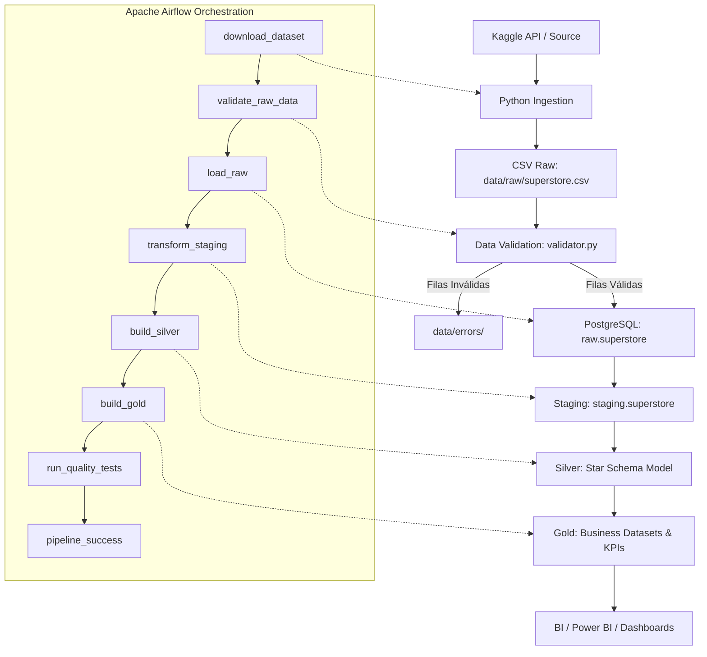

# 🛒 Superstore Sales End-to-End Data Pipeline

Pipeline de datos de extremo a extremo para el dataset **Superstore Sales** de Kaggle, diseñado con un enfoque de producción, limpio, reproducible y estructurado por capas sin sobre-ingeniería innecesaria.

---

## 📌 1. Descripción del Proyecto

Este proyecto implementa el ciclo de vida completo de ingeniería de datos:
1. **Ingesta Programática:** Descarga automática desde Kaggle (vía Kaggle API / CLI) o réplica verificada con registro de metadatos (hash SHA-256, tamaño, timestamp y conteo de filas).
2. **Capa Raw:** Preservación íntegra e inmutable del archivo fuente en `data/raw/superstore.csv`.
3. **Validación de Calidad:** Verificación estricta de schema, campos requeridos no nulos, parseabilidad de fechas, coherencia cronológica y rangos numéricos. Las anomalías se aíslan en `data/errors/`.
4. **Carga en PostgreSQL:** Ingesta idempotente en `raw.superstore`.
5. **Staging:** Limpieza técnica, conversión a `snake_case`, tipado estricto y estandarización en `staging.superstore`.
6. **Capa Silver (Modelo Dimensional):** Creación de un **Star Schema** limpio y deduplicado (`dim_date`, `dim_customers`, `dim_products`, `dim_geography`, `fact_sales`).
7. **Capa Gold (Analítica & KPIs):** Tablas agregadas listas para consumo de negocio y BI (`daily_sales`, `monthly_sales`, `category_performance`, `product_performance`, `customer_performance`, `regional_performance`).
8. **Testing Automatizado:** Suite de pruebas con Pytest para validar supuestos de datos y consistencia matemática.
9. **Orquestación:** DAG modular en **Apache Airflow** con políticas de reintentos, timeouts y logging estructurado.

---

## 🏛️ 2. Arquitectura del Pipeline

El siguiente diagrama detalla el flujo de datos y la orquestación del sistema:



---

## 🛠️ 3. Tecnologías y Justificación Técnica

| Tecnología | Rol en el Pipeline | Justificación |
| :--- | :--- | :--- |
| **Python 3.x** | Lenguaje Principal | Modularidad, manejo de archivos, validación y testing. |
| **PostgreSQL 16** | Data Warehouse / Base Analítica | Motor relacional robusto con soporte nativo de múltiples schemas (`raw`, `staging`, `silver`, `gold`). |
| **SQL** | Transformaciones de Datos | Declarativo, auditable, performante y estándar de la industria para modelado dimensional y agregaciones. |
| **Pandas / NumPy** | Inspección y Validación | Inspección exploratoria en memoria y validación declarativa de datos antes de impactar la base. |
| **Apache Airflow** | Orquestador de Flujos (DAGs) | Programación de tareas, gestión de dependencias, reintentos automáticos, timeouts y monitoreo visual. |
| **Pytest** | Testing Automatizado | Validación de aserciones de calidad de datos, pruebas unitarias y de integración. |
| **Docker Compose** | Contenedorización Ligera | Despliegue reproducible de PostgreSQL y Airflow en un solo comando sin ensuciar el sistema anfitrión. |

> **Nota:** No se introdujo Spark, Kafka, Kubernetes ni dbt para mantener el proyecto reproducible, simple y enfocado en los principios fundamentales de ingeniería de datos.

---

## 📁 4. Estructura del Repositorio

```text
arquitectura_pipeline/
│
├── data/
│   ├── raw/                  # Datos crudos inmutables y metadatos de ingesta
│   ├── processed/            # Artefactos procesados intermedios (opcional)
│   └── errors/               # Registros rechazados durante la validación
│
├── src/
│   ├── ingestion/            # Descarga desde Kaggle / fuente verificada y metadatos
│   ├── validation/           # Reglas de validación y reporte de calidad
│   ├── transformation/       # Ejecutor de scripts SQL de staging, silver y gold
│   ├── loading/              # Carga idempotente en PostgreSQL
│   ├── utils/                # Logging unificado y utilidades de base de datos
│   └── pipeline.py           # Orquestador ejecutable en línea de comandos (CLI)
│
├── sql/
│   ├── init_db.sql           # Creación de schemas (raw, staging, silver, gold)
│   ├── raw/                  # DDL de raw.superstore
│   ├── staging/              # Transformación y estandarización técnica
│   ├── silver/               # Modelo dimensional (dim_*, fact_sales)
│   └── gold/                 # Tablas agregadas y KPIs analíticos
│
├── dags/
│   └── superstore_pipeline_dag.py  # DAG de Apache Airflow
│
├── tests/
│   ├── test_validation.py    # Pruebas de validación de schema y rechazo de errores
│   ├── test_transformations.py # Pruebas de lógica matemática (márgenes, AOV, descuentos)
│   ├── test_data_quality.py  # Pruebas de supuestos del dataset
│   └── test_database_quality.py # Pruebas de integración contra PostgreSQL
│
├── notebooks/
│   └── 01_exploration.ipynb  # Notebook de Análisis Exploratorio de Datos (EDA)
│
├── docs/
│   ├── data_dictionary.md    # Diccionario de datos exhaustivo
│   └── dashboard.md          # Especificación de dashboard analítico y medidas DAX
│
├── scripts/
│   ├── run_pipeline.sh       # Script bash de ejecución directa
│   └── run_tests.sh          # Script bash de testing
│
├── docker-compose.yml        # Configuración de PostgreSQL y Airflow
├── requirements.txt          # Dependencias de Python
├── .env.example              # Plantilla de variables de entorno
├── .gitignore                # Reglas de exclusión de Git
└── README.md                 # Documentación técnica del proyecto
```

---

## ⚙️ 5. Configuración y Credenciales

### 5.1 Configuración de Variables de Entorno
Copia la plantilla `.env.example` para crear tu archivo `.env`:

```bash
cp .env.example .env
```

El archivo `.env` contiene:
```ini
# Kaggle API Credentials
KAGGLE_USERNAME=tu_usuario_kaggle
KAGGLE_KEY=tu_api_key_kaggle
KAGGLE_DATASET=bravehart101/sample-superstore-dataset

# PostgreSQL Database Connection
POSTGRES_HOST=localhost
POSTGRES_PORT=5432
POSTGRES_DB=superstore_db
POSTGRES_USER=postgres
POSTGRES_PASSWORD=postgres

# Database Schemas
POSTGRES_SCHEMA_RAW=raw
POSTGRES_SCHEMA_STAGING=staging
POSTGRES_SCHEMA_SILVER=silver
POSTGRES_SCHEMA_GOLD=gold
```

### 5.2 Autenticación con Kaggle
1. Ingresa a tu cuenta de Kaggle en [kaggle.com/settings/account](https://www.kaggle.com/settings/account).
2. En la sección **API**, haz clic en **"Create New Token"**. Se descargará un archivo `kaggle.json`.
3. Tienes dos opciones para autenticarte:
   - **Opción A (Recomendada):** Copiar los valores `username` y `key` del archivo en las variables `KAGGLE_USERNAME` y `KAGGLE_KEY` de tu archivo `.env`.
   - **Opción B:** Colocar el archivo directamente en `~/.kaggle/kaggle.json` y darle permisos:
     ```bash
     mkdir -p ~/.kaggle
     cp kaggle.json ~/.kaggle/
     chmod 600 ~/.kaggle/kaggle.json
     ```
> **Nota de Resiliencia:** Si no configuras las credenciales de Kaggle, el pipeline descargará automáticamente el dataset idéntico de 9,994 filas desde su réplica verificada para garantizar total reproducibilidad.

---

## 🚀 6. Instalación y Ejecución Local

### Paso 1: Crear el entorno virtual e instalar dependencias
```bash
python3 -m venv .venv
source .venv/bin/activate
pip install -r requirements.txt
```

### Paso 2: Iniciar PostgreSQL y Airflow con Docker Compose
```bash
docker compose up -d
```
Verifica que los servicios estén activos:
```bash
docker compose ps
```
- **PostgreSQL:** escuchando en el puerto `5432`.
- **Airflow UI:** disponible en [http://localhost:8080](http://localhost:8080) (usuario predeterminado: `admin`, contraseña generada en el log de inicio o configurada en standalone).

### Paso 3: Ejecutar el Pipeline Completo
Puedes ejecutar el pipeline mediante el script CLI:
```bash
python src/pipeline.py
```
O usando el script bash:
```bash
./scripts/run_pipeline.sh
```

Salida esperada en consola:
```text
2026-10-07 10:00:00 INFO Starting ingestion
2026-10-07 10:00:02 INFO Rows detected: 9994
2026-10-07 10:00:02 INFO Ingestion metadata written to data/raw/ingestion_metadata.json
2026-10-07 10:00:02 INFO Starting data validation on: data/raw/superstore.csv
========================================
VALIDATION RESULT
Rows checked: 9994
Valid rows: 9994
Invalid rows: 0

Checks:
✓ Required columns
✓ Data types
✓ Null values
✓ Dates
✓ Numeric values
✓ Duplicate IDs
========================================
2026-10-07 10:00:03 INFO Validation passed
2026-10-07 10:00:05 INFO Raw table loaded
2026-10-07 10:00:06 INFO Staging transformation completed
2026-10-07 10:00:07 INFO Silver transformation completed
2026-10-07 10:00:08 INFO Gold tables created
2026-10-07 10:00:09 INFO Quality tests passed
2026-10-07 10:00:09 INFO Pipeline executed successfully!
```

---

## 🧪 7. Tests Automatizados de Calidad de Datos

Ejecuta la suite completa de pruebas:
```bash
pytest -v
```
O usando el script auxiliar:
```bash
./scripts/run_tests.sh
```

La suite cubre:
- **`test_validation.py`:** Cobertura de schema, detección de nulos inesperados y aislamiento de registros corruptos en `data/errors/`.
- **`test_transformations.py`:** Aserciones sobre el cálculo del margen de beneficio, AOV, tiempos logísticos y deduplicación de dimensiones.
- **`test_data_quality.py`:** Consistencia del dataset real (9,994 filas, sin nulos, ventas y cantidades estrictamente positivas, descuentos entre 0 y 1, unicidad de Row ID).
- **`test_database_quality.py`:** Integración con PostgreSQL (verificación de conteos por tabla en raw, staging, silver y consistencia entre fact y gold).

---

## 🗄️ 8. Arquitectura de Datos en PostgreSQL

```text
PostgreSQL
├── raw
│   └── superstore             (Copia cruda fidedigna del archivo CSV)
├── staging
│   └── superstore             (Casting tipado, snake_case, trimming, sin alteraciones analíticas)
├── silver
│   ├── dim_date               (Calendario 2014-2018 con atributos temporales)
│   ├── dim_customers          (793 clientes deduplicados y segmentados)
│   ├── dim_products           (1,862 productos con nombre canónico más reciente)
│   ├── dim_geography          (Ubicaciones deduplicadas: país, región, estado, ciudad, zip)
│   └── fact_sales             (9,994 líneas de orden con claves foráneas, métricas y unit economics)
└── gold
    ├── daily_sales            (Agregado diario: pedidos, ventas, beneficio, ticket promedio, margen)
    ├── monthly_sales          (Tendencia mensual y descuento medio aplicado)
    ├── category_performance   (Ventas, rentabilidad y volumen por Categoría y Subcategoría)
    ├── product_performance    (Rendimiento por producto con flag: Star, High Volume, Loss-Maker)
    ├── customer_performance   (LTV, total de compras, fechas de primera y última orden)
    └── regional_performance   (Ventas, beneficio y tiempo promedio de despacho por estado)
```

---

## 🔄 9. Estrategia de Idempotencia

El pipeline está diseñado para ejecutarse repetidamente sin generar registros duplicados ni inconsistencias:
1. **Capa Raw:** Ejecuta `TRUNCATE TABLE raw.superstore` antes de la inserción por lotes.
2. **Capa Staging:** Se reconstruye determinísticamente a partir de `raw` asegurando tipado y consistencia.
3. **Capa Silver:** Se reconstruyen las dimensiones mediante consultas deduplicadas (`DISTINCT` y `DISTINCT ON`) y la tabla de hechos con clave primaria `row_id`.
4. **Capa Gold:** Tablas agregadas recreadas de forma atómica a partir de `silver.fact_sales`.

---

## 📊 10. Métricas de Negocio Calculadas

| Métrica | Definición SQL / Fórmula | Significado de Negocio |
| :--- | :--- | :--- |
| **Total Sales** | `SUM(sales)` | Facturación bruta generada en USD. |
| **Total Profit** | `SUM(profit)` | Beneficio neto total obtenido en USD. |
| **Total Orders** | `COUNT(DISTINCT order_id)` | Número total de pedidos únicos cursados. |
| **Total Quantity** | `SUM(quantity)` | Total de unidades físicas despachadas. |
| **Average Order Value (AOV)** | `SUM(sales) / COUNT(DISTINCT order_id)` | Importe promedio facturado por cada pedido. |
| **Profit Margin** | `SUM(profit) / NULLIF(SUM(sales), 0)` | Porcentaje de rentabilidad neta sobre ventas. |
| **Unit Price** | `sales / quantity` | Precio efectivo cobrado por unidad. |
| **Unit Cost** | `(sales - profit) / quantity` | Coste estimado de producto por unidad. |
| **Avg Days to Ship** | `AVG(ship_date - order_date)` | Tiempo promedio de despacho logístico. |

---

## 🔧 11. Solución de Problemas (Troubleshooting)

### Error: "connection to server at 127.0.0.1, port 5432 failed"
- **Causa:** El contenedor de PostgreSQL no está iniciado.
- **Solución:** Ejecuta `docker compose up -d` y espera unos segundos a que el contenedor pase a estado `healthy`.

### Error: "401 Unauthorized" o "403 Forbidden" al descargar desde Kaggle
- **Causa:** Credenciales de Kaggle incorrectas o ausentes en el archivo `.env`.
- **Solución:** Revisa `KAGGLE_USERNAME` y `KAGGLE_KEY` en tu `.env`, o permite que el sistema utilice automáticamente la fuente pública verificada configurada por defecto.

### Error: "ModuleNotFoundError" al ejecutar pytest
- **Causa:** El entorno virtual no está activado.
- **Solución:** Ejecuta `source .venv/bin/activate` antes de correr los comandos.

---

## 📄 12. Licencia y Créditos
Dataset original por Tableau / Kaggle (**Superstore Sales Dataset**). Diseñado con fines educativos y de práctica profesional en ingeniería de datos.
