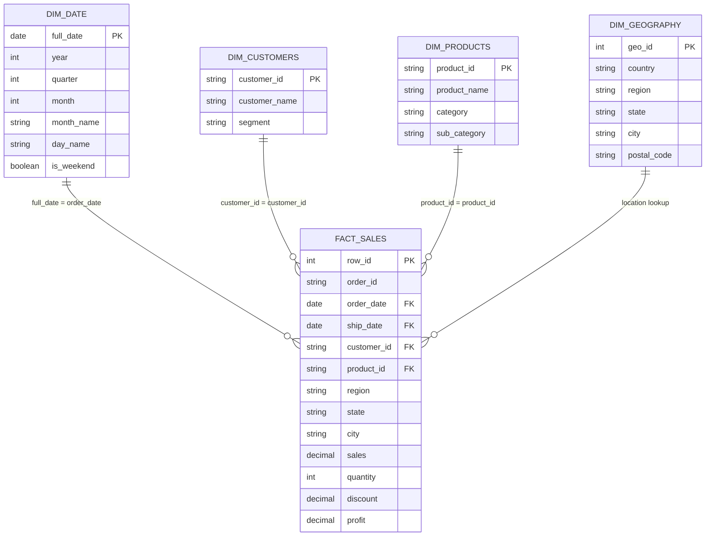

# 📊 Especificación de Dashboard BI (Power BI / Metabase / Tableau)

Este documento define la arquitectura analítica, el modelo de datos y la estructura de visualización recomendada para consumir la capa **Silver** y **Gold** del pipeline en herramientas de Business Intelligence (e.g. Power BI).

---

## 1. Modelo de Datos Analítico (Star Schema)

Para dashboards interactivos con filtrado cruzado por fechas, clientes y geografías, la fuente recomendada es el **Star Schema** de la capa `silver` o las tablas pre-agregadas de la capa `gold`:



### Tabla de Hechos Principal:
- **`silver.fact_sales`**: Granularidad a nivel de línea de orden (`row_id`). Contiene las medidas numéricas primarias: `sales`, `quantity`, `discount`, `profit`.

### Dimensiones Principales:
- **`silver.dim_date`**: Permite jerarquías de tiempo (Año → Trimestre → Mes → Día).
- **`silver.dim_customers`**: Segmentación por cliente y tipo de cliente (`Consumer`, `Corporate`, `Home Office`).
- **`silver.dim_products`**: Jerarquía de catálogo (`Category` → `Sub-Category` → `Product Name`).
- **`silver.dim_geography`**: Jerarquía geográfica (`Region` → `State` → `City`).

---

## 2. Métricas y Fórmulas DAX

### Métricas Pre-calculadas en la Capa Gold:
Las tablas de la capa `gold` ya contienen KPIs agregados a nivel tabla:
- `gold.daily_sales`: Ventas, órdenes, clientes únicos y margen diario.
- `gold.monthly_sales`: Tendencia mensual de ventas, pedidos y AOV.
- `gold.category_performance`: Desempeño consolidado por categoría y subcategoría.
- `gold.product_performance`: Clasificación de productos (Estrella, Alto Volumen, Generador de Pérdidas).
- `gold.customer_performance`: LTV y frecuencia por cliente.
- `gold.regional_performance`: Rentabilidad y tiempos logísticos por estado y región.

### Medidas DAX Recomendadas (para interactividad en `silver.fact_sales`):

1. **Ventas Totales:**
   ```dax
   Total Sales = SUM(fact_sales[sales])
   ```

2. **Beneficio Total:**
   ```dax
   Total Profit = SUM(fact_sales[profit])
   ```

3. **Margen de Beneficio (%):**
   ```dax
   Profit Margin % = DIVIDE([Total Profit], [Total Sales], 0)
   ```

4. **Total de Pedidos:**
   ```dax
   Total Orders = DISTINCTCOUNT(fact_sales[order_id])
   ```

5. **Ticket Promedio (AOV):**
   ```dax
   Average Order Value = DIVIDE([Total Sales], [Total Orders], 0)
   ```

6. **Unidades Vendidas:**
   ```dax
   Total Quantity = SUM(fact_sales[quantity])
   ```

7. **Descuento Promedio (%):**
   ```dax
   Avg Discount % = AVERAGE(fact_sales[discount])
   ```

---

## 3. Estructura de Páginas del Dashboard

### Página 1: Executive Overview (Resumen Ejecutivo)
- **Objetivo:** Visión general de alto nivel para directores y gerencia.
- **KPI Cards principales:** 
  - Ventas Totales ($2.29M)
  - Beneficio Neto ($286.4K)
  - Margen Global (12.47%)
  - Total de Pedidos (5,009)
  - Clientes Activos (793)
- **Visualizaciones:**
  - Gráfico de Líneas: Evolución mensual de Ventas y Beneficio (2014 - 2017).
  - Gráfico de Donut: Distribución de Ventas por Categoría (`Technology`, `Furniture`, `Office Supplies`).
  - Mapa de calor / Treemap: Ventas y Margen por Región (`West`, `East`, `Central`, `South`).
- **Filtros Globales:** Año, Trimestre, Región.

---

### Página 2: Sales Analysis (Análisis de Ventas)
- **Objetivo:** Profundizar en estacionalidad, tendencias y valor del ticket.
- **Visualizaciones:**
  - Gráfico de Barras Agrupadas: Ventas del Año Actual vs Año Anterior (YoY Growth).
  - Gráfico de Columnas: Ticket Promedio (AOV) por Mes.
  - Gráfico de Dispersión: Relación entre Tasa de Descuento y Margen de Beneficio (demuestra el umbral crítico del 20% de descuento).
  - Matriz: Ventas por Día de la Semana y Mes.

---

### Página 3: Product Performance (Análisis de Productos)
- **Objetivo:** Identificar productos estratégicos y aislar referencias no rentables.
- **Visualizaciones:**
  - Gráfico de Barras Horizontales: Top 10 Productos con Mayor Facturación.
  - Gráfico de Barras Horizontales con formato condicional (Rojo/Verde): Top 10 Productos con Mayor Margen vs Top 10 con Mayor Pérdida.
  - Tabla Detallada con Flags: `product_id`, `product_name`, `category`, `sub_category`, `total_sales`, `profit_margin`, `performance_flag`.
- **Filtros:** Selector de Categoría y Subcategoría.

---

### Página 4: Customer Analysis (Análisis de Clientes)
- **Objetivo:** Entender la base de clientes, fidelidad y rentabilidad por segmento.
- **Visualizaciones:**
  - Gráfico de Barras Apiladas: Ventas y Beneficio por Segmento (`Consumer`, `Corporate`, `Home Office`).
  - Tabla Top 20 Clientes: Nombre, Segmento, Órdenes, Ventas Totales, Beneficio y Margen.
  - Histograma: Distribución de pedidos por cliente (frecuencia de compra).

---

### Página 5: Regional & Logistics Analysis (Análisis Regional y Logístico)
- **Objetivo:** Control operacional geográfico y cumplimiento de entregas.
- **Visualizaciones:**
  - Mapa coroplético de EE.UU.: Ventas y Margen por Estado.
  - Gráfico de Barras: Tiempo promedio de despacho (`avg_days_to_ship`) por `Ship Mode`.
  - Tabla comparativa por Estado: Ventas, Beneficio, Margen %, Tiempo Promedio de Entrega.
